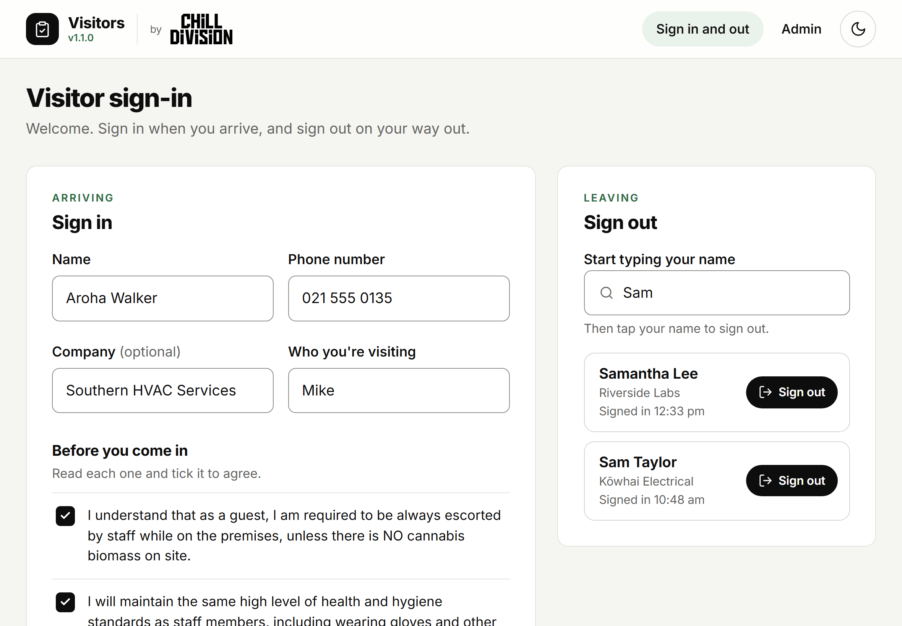
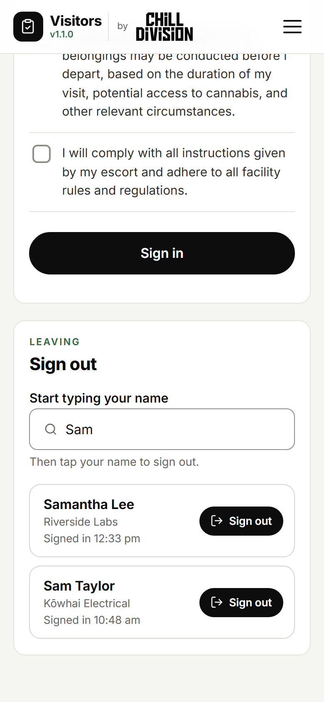
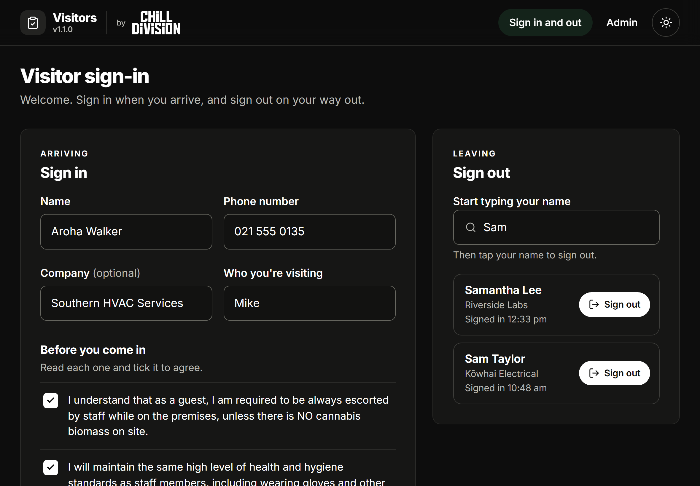
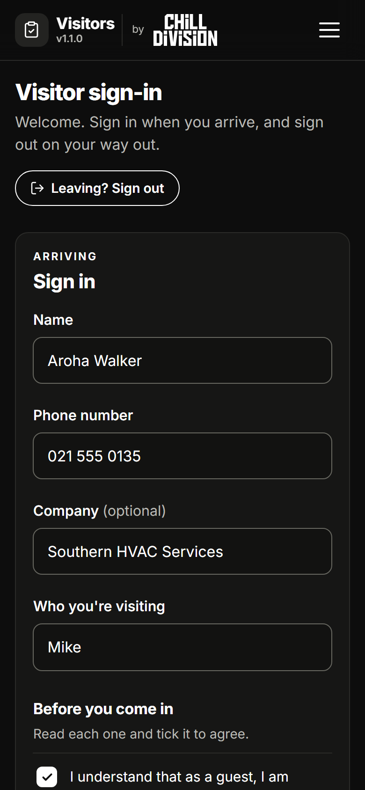
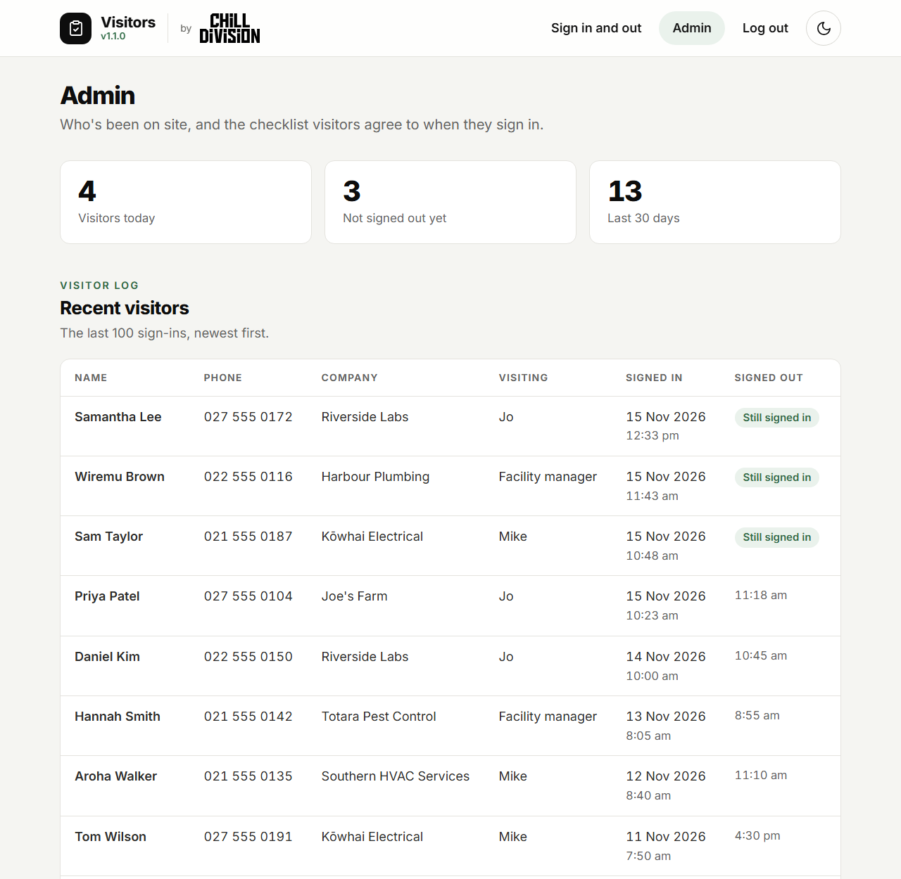
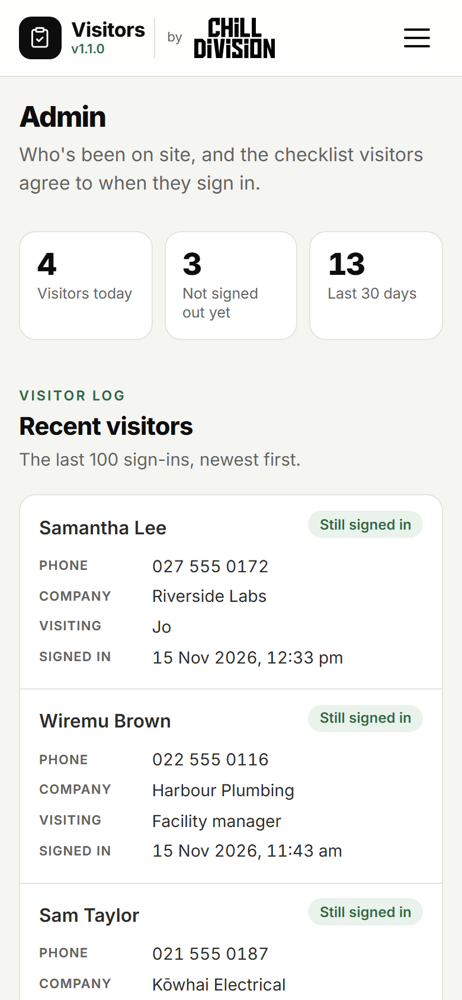
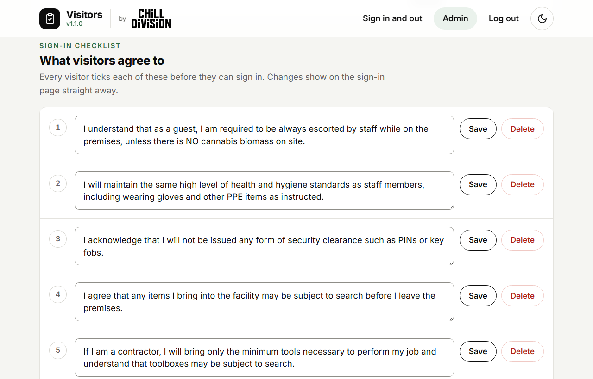

# Visitors, a sign-in and sign-out tracker for Home Assistant

A simple visitor register for your facility, as a Home Assistant app. Free and open source, from Chill Division.

Visitors sign in on a tablet at the door, tick off your site rules, and sign themselves out when they leave. Signing out takes a few seconds, so there's no queue at the door. And if someone forgets, nothing breaks. You'll see who didn't sign out on the admin page.

 

* Quick to sign in. Name, phone number, company and who they're visiting, then your checklist.
* Even quicker to sign out. Start typing your name and tap it.
* Your own checklist. Change, add or remove the rules every visitor agrees to.
* Private at the door. The sign-out search shows names, companies and times, never phone numbers.
* Light or dark, in the same look as our [GRACe Portal](https://github.com/Chill-Division/GRACe_repo).
* Stays on your Home Assistant box, and works with no internet.

## Light or dark

Tap the moon in the menu bar for the dark theme, and the sun to switch back. Each tablet or phone remembers its own choice.

 

## The admin page

Tap Admin and enter your admin password to see who's been on site, newest first, with their phone numbers. The admin page also has a quick count of today's visitors and who hasn't signed out yet.

 

Below the log is the checklist every visitor ticks before they can sign in. Edit an item and tap Save, delete the ones you don't need, or add your own. Changes show on the sign-in page straight away.

## Installation

Home Assistant has called add-ons "apps" since 2026.2, so on an older Home Assistant read "Add-ons" wherever these steps say "Apps".

Or add it by hand:

1. In Home Assistant, go to Settings -> Apps and open the app store.
2. Tap the 3-dot menu in the upper-right and choose "Repositories".
3. In the "Add" box, enter `https://github.com/Chill-Division/visitors_repo`, then click "Add" and "Close".
4. You may need to tap the 3-dot menu again and choose "Check for updates". "Visitors Sign-in" then shows up under the new repository.
5. Tap it, select "Install", then turn on "Show in sidebar" and "Auto update", and tap "Start".

## Set your admin password

Until you set one, the admin password is `cannabis`, and the admin page reminds you to change it. Open the app's Configuration tab, fill in `admin_password`, save, then restart the app.

## Your data and backups

Everything Visitors records is stored inside the app, so it survives updates and is included in your Home Assistant backups. Make sure automatic backups are turned on and copied somewhere off the box.

## For developers

[DEVELOPMENT.md](DEVELOPMENT.md) covers running the pages on your own PC with made-up visitors, refreshing these screenshots, and the release checklist.
